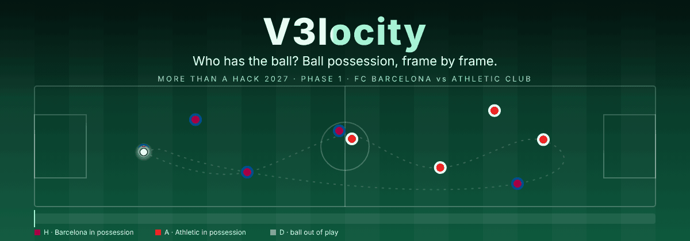
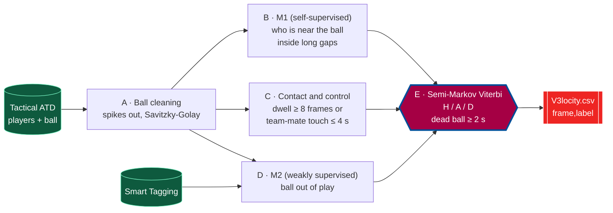

<div align="center">



<br/>


**[How it works](#-how-it-works)** ·
**[Results](#-results-at-a-glance)** ·
**[Reproduce](#-reproduce-the-submission)** ·
**[What we dropped](#-what-we-tried-and-dropped)** ·
**[Technical document](docs/V3locity.pdf)** ·
**[Team](#-team-v3locity)**

</div>

---

## ⚽ The task in one line

For every one of the **199,319 frames** of FC Barcelona vs Athletic Club, decide who has the ball:

| Label | Meaning |
|:---:|---|
| 🟪 `H` | Barcelona (home) in possession |
| 🟥 `A` | Athletic (away) in possession |
| ⬜ `D` | Dead ball: out of play, before a restart |
| `X` | Not graded (before kick-off, half-time, after the final whistle) |

The ranking metric is **spellF1**: it scores whole possessions (spells), not single frames. A model that flickers between teams creates dozens of tiny spells and loses most of its score, even if its frame accuracy looks fine. That one fact shaped our whole design.

> [!NOTE]
> The tracking loses the ball on about **41% of graded frames**, often for several seconds at a time (median gap 10.7 s). Most of this repository deals with what happens while the ball is missing.

---

## 🧠 How it works

We decode each half in one pass with a **semi-Markov Viterbi** over three states (H, A, D). The decoder sees the whole half, so it places each change of possession at the first touch of the new team instead of the moment control is confirmed.



<details>
<summary><b>Stage by stage (click to expand)</b></summary>

<br/>

| Stage | What it does | Key settings |
|---|---|---|
| **A · Ball cleaning** | Drops samples > 8 m outside the pitch, jumps > 40 m/s and blips < 3 frames, then smooths each run | Savitzky-Golay, window 7, order 2 |
| **B · M1, self-supervised** | Hides the ball over artificial gaps cut from frames where it is visible and learns which team has the closest player (≤ 2 m) from the gap ends and the layout of all players | XGBoost, 4-fold GroupKFold over 2-min blocks, out-of-fold AUC 0.862 |
| **C · Contact and control** | Contact = nearest player ≤ 1 m from a reliable ball. Control = dwell ≥ 8 frames (0.32 s) **or** the next team touch within 4 s is by a team-mate | Duels keep the previous possessor |
| **D · M2, weakly supervised** | Dead-ball model built on the Laws of the Game: ball over the lines, collective slow-down, throw-in taker beyond the touchline, players at the corner arc, kick-off shape, stationary ball at a restart spot | Weak labels from Smart Tagging, out-of-fold AUC 0.800 |
| **E · Decoding** | Team log-odds from control evidence (+ 0.1 × M1 inside long gaps), dead log-odds = 0.25 × logit(M2) | Switch cost H↔A 10, alive↔dead 8, dead stretch ≥ 50 frames |

</details>

### 📏 Possession rules we implemented

- 🔁 A change of possession needs **control** by the other team. Single touches, deflections and duels leave the ball with the previous possessor.
- 🌀 Loose and contested balls stay with the **last team in control**.
- ⏸️ Dead ball is never a possession. After a restart, the next controlled touch in the tracking decides the team; we do not copy it from the Smart Tagging.
- 📖 Grounded in IFAB Laws 8, 9 and 13 to 17 and in Link & Hoernig (2017).

---

## 📊 Results at a glance

Scores on the **public 5-minute window** (17 possessions). Numbers in brackets are 90% bootstrap intervals.

| Scenario | spellF1 | macroF1 | Restarts recovered | Median latency | Team agreement |
|---|:---:|:---:|:---:|:---:|:---:|
| S1 · LightGBM | 0.411 [0.278, 0.544] | 0.618 | 0.695 | -13.5 fr | 0.637 |
| 🏁 **S2 · XGBoost (submitted)** | **0.400** [0.244, 0.544] | **0.623** | **0.695** | **-5 fr** | **0.644** |
| S3 · CatBoost | 0.400 [0.256, 0.544] | 0.630 | 0.492 | -12 fr | 0.649 |
| S4 · Random forest | 0.354 [0.206, 0.491] | 0.502 | 0.237 | -7 fr | 0.633 |
| S5 · Ensemble | 0.378 [0.222, 0.533] | 0.636 | 0.542 | -6 fr | 0.634 |
| S6 · Video ball + ensemble | 0.337 [0.189, 0.484] | 0.545 | 0.559 | -21 fr | 0.648 |
| Official baseline `smooth50` | 0.326 | 0.621 | 0.763 | n/a | 0.643 |

> [!IMPORTANT]
> The public intervals of S1, S2, S3 and S5 overlap almost completely, and the organisers show that choosing on the public window can pick the wrong model. We chose **S2** on full-match diagnostics instead: it recovers the most set-piece restarts (tied with S1), places transitions closest in time (median 5 frames early) and has stronger M1 and M2 models than S1.

<details>
<summary><b>What the diagnostic columns mean</b></summary>

<br/>

- **Restarts recovered**: share of `SET PIECES` tags with a predicted restart (D → H or A) inside the tag or within 2 s after it. Full match.
- **Median latency**: median offset of matched transitions on the public window, in frames (25 frames = 1 s). Negative means early.
- **Team agreement**: share of predicted H and A frames inside team-tagged Smart Tagging phases that match the tagged team. Full match.

</details>

---

## 🔬 What we tried and dropped

<details>
<summary><b>Finding the ball in the video with YOLO (scenario S6)</b></summary>

<br/>

Since the tracking loses the ball so often, we trained a single-class **YOLO** detector (Ultralytics `yolo26s`) on 960 × 960 crops of the tactical video. Labels came from tracked ball positions projected with the homography. No frame was labelled by hand.

| | Version 2 | Version 3 |
|---|:---:|:---:|
| Label centre | projected tracking position | teacher detector + blob refinement |
| Box size | ≥ 20 px | calibrated to apparent ball size, ≥ 15 px |
| Hard negatives | none | 356 (ball inpainted out) |
| Selection | best detection per frame | precision-based threshold + physical track filter |
| Detector mAP50 (own validation) | 0.15 | **0.99** |
| Detections within 1.5 m of tracked ball | 0.69 | 0.71 |
| Public spellF1 of S6 | 0.337 | 0.337 |

**Lesson.** The projected tracking position sits about one ball diameter (median 7.8 px) away from the visible ball, which explains why the first detector boxed grass and feet. Fixing the labels made the detector far better, yet the possession score did not move. Every scenario has a transition F1 at ±1 s of 0.10 or less. The limit lies in **when** possession changes, not **where** the ball is.

</details>

| Asset | Status |
|---|---|
| Tactical ATD (players + ball) | ✅ all stages |
| Smart Tagging | ✅ weak labels for M2, independent team check |
| Homography (tactical) | ✅ error analysis, video projection in S6 |
| Tactical video | 🧪 tried in S6, not in the submitted file |
| Broadcast video and ATD | ❌ dropped: not synchronised with the tactical timeline |

---

## 🚀 Reproduce the submission

> [!TIP]
> S2 runs on **CPU only**. A CUDA GPU is needed only for the video scenario S6, which the steps below skip.

**1. Get the code and the pinned environment**

```bash
git clone https://github.com/muhammadfuad249/V3locity_More-Than-a-Hack-2027.git
cd V3locity_More-Than-a-Hack-2027
python -m venv .venv && source .venv/bin/activate      # Windows: .venv\Scripts\activate
pip install -r docs/requirements_used.txt
```

**2. Add the official data bundle** (not included here, see [Data](#-data-and-competition-rules))

```text
data/
└── tactical/
    ├── BAR-ATH_tactical_atd.txt
    ├── BAR-ATH_tactical_atd.xml
    ├── BAR-ATH_tactical_smart_tagging.xml
    └── BAR-ATH_tactical_homography.csv
```

**3. Run scenario S2 headless**

```bash
export MTAH_NB_CONFIG='{"team_name": "V3locity", "data_dir": "data", "work_dir": "work", "scenarios": {"S2": {"name": "XGBoost", "source": "atd", "model": "xgb"}}}'
jupyter nbconvert --to notebook --execute --ExecutePreprocessor.timeout=-1 \
    MTAH2027_Possession_Scenarios_v3.ipynb --output run_S2.ipynb
```

<details>
<summary>Windows PowerShell</summary>

```powershell
$env:MTAH_NB_CONFIG = '{"team_name": "V3locity", "data_dir": "data", "work_dir": "work", "scenarios": {"S2": {"name": "XGBoost", "source": "atd", "model": "xgb"}}}'
jupyter nbconvert --to notebook --execute --ExecutePreprocessor.timeout=-1 MTAH2027_Possession_Scenarios_v3.ipynb --output run_S2.ipynb
```

</details>

You can also open the notebook and press **Run all**. The JSON above overrides the `CONFIG` cell; without it, set `data_dir` (the folder that contains `tactical/`) and `work_dir` there.

**4. Check the output**

```text
work/runs_v3/<RUN_ID>/scenarios/S2_XGBoost/
├── V3locity.csv        ← the submission
├── validation.txt      ← output of the official validator
├── scores.json         ← public-window scores
└── V3locity.md         ← technical summary for this scenario
```

```bash
sha256sum work/runs_v3/*/scenarios/S2_XGBoost/V3locity.csv
# expected: 3fca39c4b618e106adebec913e90551e3c03cbe80eec793509e75f5ecca5022f
# (the same hash as submission/V3locity.csv in this repository)
```

> [!NOTE]
> We pin seed 2027, `n_threads = 8` and GBDT on CPU. With the versions in `docs/requirements_used.txt` our reruns produce the same file byte for byte. A different thread count or library version can change the floating-point order and therefore a few labels.

---

## 🗂️ Repository layout

```text
.
├── assets/
│   ├── banner.gif                              # animated banner
│   └── banner.png                              # static fallback
├── docs/
│   ├── V3locity.pdf                            # short technical document (submitted)
│   ├── V3locity.docx                           # editable version of the same document
│   ├── V3locity.md                             # Markdown version of the same document
│   └── requirements_used.txt                   # pinned versions used for the submission
├── submission/
│   └── V3locity.csv                            # the submitted possession file (frame,label)
├── MTAH2027_Possession_Scenarios_v3.ipynb      # the pipeline used for the submission (S1 to S6)
├── MTAH2027_Possession_Scenarios Final.ipynb   # earlier version (v2), kept for reference
├── README.md
└── .gitignore                                  # keeps data, runs, checkpoints and weights out of git
```

---

## 🔒 Data and competition rules

> [!WARNING]
> **The match data is not in this repository and must never be committed.** The bundle is not redistributable. `.gitignore` excludes `data/`, `work/`, videos and model weights, and the notebook is committed **with outputs cleared**, because some cells plot frames from the video.

- 🤖 **Labels come from an algorithm only.** No frame was annotated by hand.
- 🔐 The **private ground truth** was never used. The public 5-minute window served as a correctness check.
- ☁️ No video, dataset or extract was uploaded to any cloud-hosted LLM.

---

## 📚 Technical document and references

The full method, rules, limitations and reproduction notes are in **[docs/V3locity.pdf](docs/V3locity.pdf)** (also as [Word](docs/V3locity.docx) and [Markdown](docs/V3locity.md)).

- IFAB. *Laws of the Game 2025/26*. The International Football Association Board, 2025.
- Daniel Link and Martin Hoernig. "Individual ball possession in soccer." *PLoS ONE* 12(7): e0179953, 2017.
- Ferran Vidal-Codina, Nicolas Evans, Bahaeddine El Fakir and Johsan Billingham. "Automatic event detection in football using tracking data." *Sports Engineering* 25(1): 18, 2022.
- Andrew J. Viterbi. "Error bounds for convolutional codes and an asymptotically optimum decoding algorithm." *IEEE Transactions on Information Theory* 13(2): 260-269, 1967.
- Abraham Savitzky and Marcel J. E. Golay. "Smoothing and differentiation of data by simplified least squares procedures." *Analytical Chemistry* 36(8): 1627-1639, 1964.
- Tianqi Chen and Carlos Guestrin. "XGBoost: A scalable tree boosting system." *Proc. KDD 2016*: 785-794.

---

## 👥 Team V3locity

| | Member | Role |
|:---:|---|---|
| 👑 | **Muhammad Nur Fuad** (team lead) | Pipeline architecture, Viterbi decoding, integration and submission |
| 🗄️ | **Asrul** | Data engineering: tracking parser, ball cleaning, data-quality checks |
| 📈 | **Raihan Nur Rizqillah** | Machine learning: M1 gap model, M2 dead-ball model, scenario comparison |
| 🎥 | **Wa Ode Namida Heiwa** | Computer vision: YOLO ball-detection experiment (S6) |
| 📝 | **Wa Ode Resky Aulia A.** | Football rules, evaluation and technical documentation |

<div align="center">

<br/>

### 🏟️ The competition

[](https://landing.mobileworldcapital.com/more-than-a-hack-2027)
[](https://github.com/metrica-sports/more-than-a-hack-2027)

Organised by **Barça Innovation Hub**, **Metrica Sports** and **MWCapital**.<br/>
Match: **FC Barcelona vs Athletic Club** (tactical camera, 199,319 frames).<br/>
<sub>This is an independent competition entry. It is not affiliated with or endorsed by the clubs or the organisers.</sub>

<br/><br/>

[](LICENSE)<br/>
<sub>AGPL-3.0 because the notebook imports Ultralytics YOLO (AGPL-3.0) for scenario S6.</sub>

</div>
